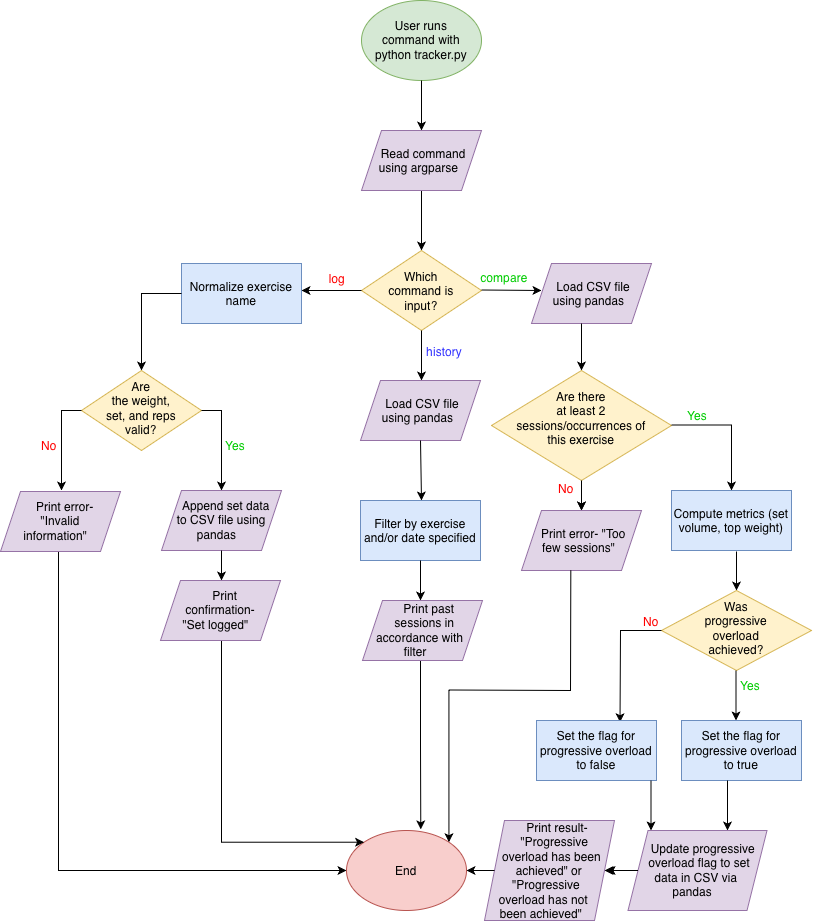
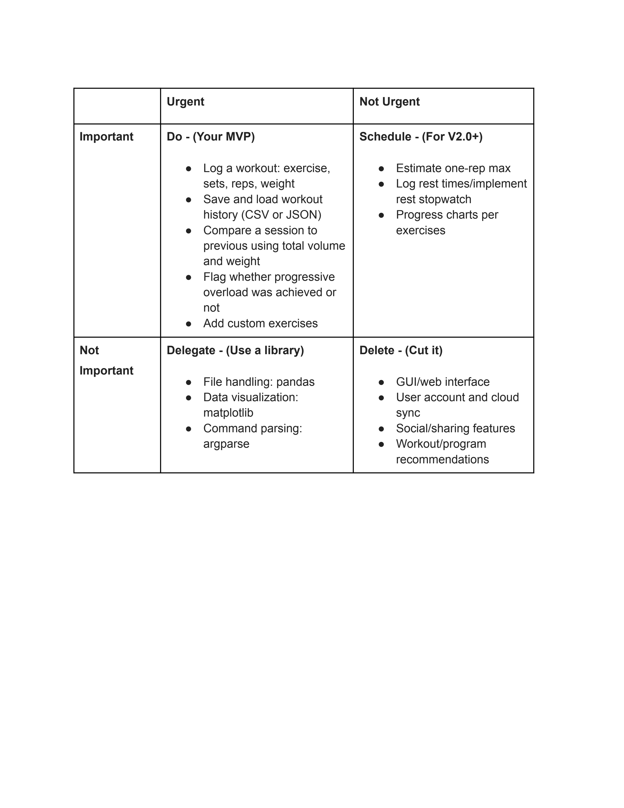

# Workout Logger

A command-line tool for logging workouts and tracking progressive overload from session to session.

## The Problem

Progressive overload (gradually increasing load, repetitions, or achieving better form over time) is the primary driver of muscular hypertrophy, and lifters ensure they achieve it mainly through tracking their workouts and looking at general trends. Current tracking apps make it hard to see whether you've actually beaten your previous session, and their limited exercise selection makes it challenging to log the variations that many lifters use. Due to these flaws, many lifters end up stalling progression.

## How It Works

Version 1.0 (MVP) does 4 things:
- **Log a set:** record any exercise, set number, weight, and reps from the command line
- **Save and load history:** every set is stored as a row in a CSV file
- **Compare sessions:** compare an exercise's most recent session to the previous one
- **Flag progressive overload:** save whether overload was achieved and print the result

**How progressive overload is measured:** A set counts as progressive overload if its weight or reps increased compared to the matching set from the previous session. Adding extra sets does not count.

## Future Plans

- [ ] Estimated one-rep max calculation
- [ ] Log rest times / built-in rest stopwatch
- [ ] Progress charts per exercise

## Tech Stack

- **Language:** Python
- **Libraries:** pandas, argparse, datetime, matplotlib (post-MVP)
- **Data storage:** CSV file (one row per set)
- **Other tools:** Git and GitHub
